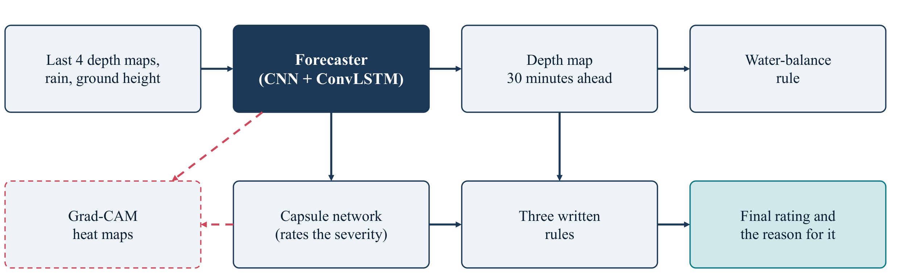
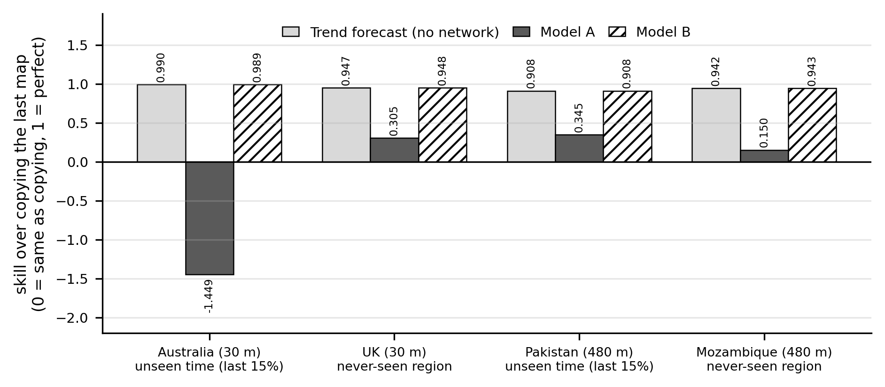

# Can a neural network forecast a flood?

A scroll-through website for our Deep Learning CA3 project, **CNN-LSTM Based Spatiotemporal Flood Evolution Forecasting**.

**Live site:** https://amans-06.github.io/FloodCastBench-Project/



## What the project is about

A flood can be drawn as a series of water-depth maps. We give a neural network the last four maps, plus the rain that has already fallen and the height of the ground, and ask it to draw the map for 30 minutes later.

The catch is that in 30 minutes the water in most places hardly changes. So just copying the last map is already a very good forecast. We therefore score every model against simple forecasts, and we ask one honest question: is the neural network really better than very simple rules?

We worked on **FloodCastBench**, a public dataset of four floods that were re-created with a physics simulator: Australia (Feb 2022), the UK (Dec 2015), Pakistan (Aug 2022) and Mozambique (Mar 2019). The models learn on Australia and Pakistan and are tested on the UK and Mozambique, which they never see while training.

## What we built

- **A forecaster**: a convolutional neural network (CNN) followed by a ConvLSTM layer, with 62,833 parameters, written in TensorFlow and Keras.
- **Two versions of it**: Model A starts from the last map, and Model B starts from a simple trend forecast and only learns a small correction.
- **A capsule network** that rates how serious the flooding will be (none, minor, moderate or severe).
- **Written rules** that check the capsule network and give a reason for every decision. This is the NeuroSymbolic AI part: a neural network checked by rules people can read.
- **Grad-CAM** heat maps that show where the models look. This is the explainable AI part.
- **A water-balance rule** that checks the total amount of water in a forecast against the rain.

## What we found



- At 30 minutes ahead, a simple **trend forecast** (the last map plus a fraction of the last change, one fitted number, no network) scored 0.91 to 0.99. Our first model, Model A, scored only 0.15 to 0.35 on the three tests where it beat copying, and it was worse than copying on the last part of the Australia flood (skill -1.449).
- Model B, which starts from the trend, matched the trend in every test but did not beat it. At 30 minutes only 1% to 9% of the error of copying is left for any model to remove.
- In a larger laptop study of about **310 training runs**, forecasting up to 2.5 hours ahead, a very simple linear model of each square's recent depths scored 0.79 to 0.82. The best networks scored 0.81 to 0.87.
- When trained for the same length, the ConvLSTM and a plain CNN scored the same. The ConvLSTM did lose less skill as the forecast reached further ahead. We did not test why.
- The capsule network did not clearly beat a plain output layer once we added rotated and flipped copies of the data. The written rules raised the severity accuracy in all four floods.
- The Grad-CAM maps of the forecaster follow river channels, flood edges and rain blocks. The maps of the capsule network were weak, so we treat them as pictures and not as proof.

The biggest lesson: **always compare a model with simple forecasts.** Our first model looked good until we did.

Skill is `1 - (error of the forecast / error of copying the last map)`. A skill of 0 means no better than copying, and 1 means perfect.

## Limits

- Every region has one flood, so there are only two truly independent train-and-test pairs.
- The floods are simulated, so the models learn to imitate a simulator and not real floods.
- The Colab results come from single runs.
- The capsule network and Grad-CAM were built on Model A and not rebuilt on Model B.

## About this website

The site is a single static page. The picture on the right changes as you scroll through the story, which has five parts: the floods, the model, what happened, a bigger study on a laptop, and how bad the flooding is and why.

```
index.html        the page and its text
style.css         the styles
scrollama.min.js  scroll-driven storytelling library
images/           all the figures used on the page
LICENSE           MIT licence
```

To view it on your own computer, download the repository and run a small web server in its folder:

```
python -m http.server 8000
```

Then open http://localhost:8000. The page also loads D3 from the internet, so you need to be online.

## Authors

Anhad Mahajan (PRN 24070126031) and Aman Sumeet Saxena (PRN 24070126030), AIML A2, Symbiosis Institute of Technology, Pune. Deep Learning CA3, October 2026.

## Credits

- **Data:** Q. Xu, Y. Shi, J. Zhao and X. X. Zhu, *FloodCastBench: a large-scale dataset and foundation models for flood modeling and forecasting*, Scientific Data, 2025.
- **Scrolling effect:** the page is built on the [scrollama](https://github.com/russellsamora/scrollama) demo by Russell Samora, used under the MIT licence.
- **Methods:** ConvLSTM (Shi et al., 2015), capsule networks (Sabour et al., 2017) and Grad-CAM (Selvaraju et al., 2017).

## Licence

MIT. See the `LICENSE` file.
